# PCA / SVD from scratch + visualization

Principal Component Analysis in NumPy with a scikit-learn-style API and **five interchangeable solvers**. Three of them are written from scratch: a one-sided Jacobi SVD, power iteration with deflation, and a Halko et al. randomized SVD. The exact solvers match scikit-learn to 1e-12, power iteration matches it to its 1e-10 tolerance, and the randomized solver is approximate by design. The project is illustrated with eigenfaces, the geometry of a Gaussian cloud, and SVD image compression.


<p align="center">
  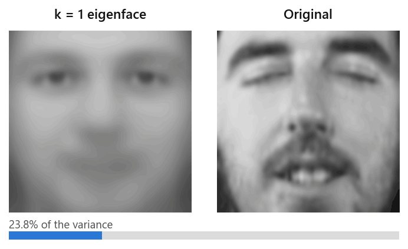
</p>

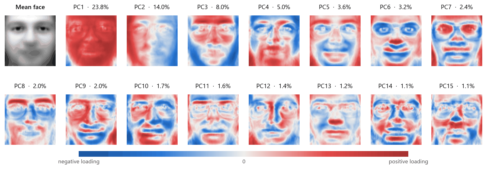

## Key results

All numbers below come from `python demo.py` and `python benchmark.py` (raw values in [`results/metrics.json`](results/metrics.json)).

**Agreement with scikit-learn.** Olivetti faces (400 × 4096), k = 50 components. Every solver is compared with the exact reference `sklearn.decomposition.PCA(svd_solver="full")`. The "excess" column is the relative increase of the reconstruction MSE over the Eckart–Young optimum (2.431 × 10⁻³ per pixel).

| Solver (`PCA(solver=…)`) | Built on | max \|Δ component\| | max rel. error of λᵢ | MSE excess | sklearn counterpart: max \|Δ component\| / MSE excess |
|---|---|---|---|---|---|
| `svd` | LAPACK SVD of $X_c$ | 2.1e-14 | 3.6e-15 | 0 | `full`: 0 / 0 |
| `covariance_eigh` | LAPACK `eigh` of the 400 × 400 **Gram** matrix | 1.9e-14 | 6.3e-15 | 0 (rounding) | `covariance_eigh` (4096 × 4096 covariance): 2.3e-14 / 0 |
| `jacobi` | **from scratch**: QR + one-sided Jacobi rotations | 4.3e-13 | 1.8e-13 | 0 (rounding) | none |
| `power` | **from scratch**: power iteration + deflation | 9.4e-10 | 5.9e-15 | 0 (rounding) | `arpack`: 1.6e-14 / 0 |
| `randomized` | **from scratch**: Halko et al., q = 4 power iterations | 5.6e-2 | 2.8e-2 | 1.98e-3 | `randomized`: 9.3e-2 / 3.25e-3 |

* With all 399 non-null eigenfaces (the centred data has rank n − 1), the exact solvers still match scikit-learn to **8.0e-14** (`svd`), **5.0e-13** (`covariance_eigh`) and **4.1e-12** (`jacobi`).
* The randomized solvers are only approximate on this slowly decaying spectrum. Over 5 seeds, ours has a lower reconstruction error than scikit-learn's at every number of power iterations q. On singular values the two are comparable for q ≤ 3, and ours is more accurate from q = 4 on (4.8× lower error at q = 10). The likely reason is that QR re-orthonormalisation keeps full precision, while scikit-learn's default LU normalisation does not ([figure](assets/randomized_power_iterations.png)).

**Speed.** Median fit time over 7 runs. See [Reproducibility](#reproducibility) for the hardware and measurement conditions.

| Algorithm family | Olivetti 400 × 4096, k = 50: ours / sklearn | Tall 20,000 × 300, k = 20: ours / sklearn |
|---|---|---|
| Full SVD (LAPACK) (`svd` vs `full`) | 0.215 s / 0.169 s | 0.207 s / 0.188 s |
| Covariance / Gram eigh (`covariance_eigh` vs `covariance_eigh`) | 0.040 s / 3.217 s | 0.037 s / 0.031 s |
| Randomized SVD (`randomized` vs `randomized`) | 0.091 s / 0.049 s | 0.097 s / 0.082 s |
| Power iteration \| ARPACK (`power` vs `arpack`) | 0.725 s / 0.060 s | 0.046 s / 0.049 s |
| One-sided Jacobi SVD (`jacobi`) | 3.584 s / n/a | 1.329 s / n/a |

**Eigenfaces.** PC1 alone explains 23.8 % of the pixel variance and PC2 14.0 %. The variance thresholds are reached at k = 4 (50 %), 27 (80 %), 66 (90 %), 123 (95 %) and 260 (99 %).

**Generalization** (320 training / 80 held-out images, 2 per subject). The training error reaches 0 at k = 319, but the held-out reconstruction MSE plateaus at 1.49 × 10⁻³. 1-nearest-neighbour identification in eigenface space first reaches **96.25 % (77/80) at k = 20**, the accuracy of 1-NN on the raw 4096-D pixels. For larger k it stays within one image of that value (95.0–97.5 %).

**Truncated-SVD compression** of a 768 × 1024 photo. The measured squared error equals the Eckart–Young bound $\sum_{i>k}\sigma_i^2$ up to a relative gap of at most 1.7 × 10⁻¹⁶.

| rank k | storage $k(m+n+1)/mn$ | PSNR | randomized SVD (q = 4): error / optimum |
|---|---|---|---|
| 5 | 1.1 % | 17.7 dB | 1.0000000 |
| 20 | 4.6 % | 21.4 dB | 1.0003 |
| 50 | 11.4 % | 24.2 dB | 1.0045 |
| 100 | 22.8 % | 27.7 dB | 1.0066 |

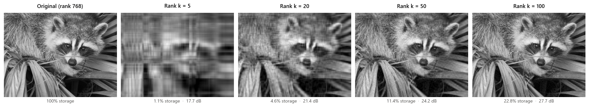

## How it works

### PCA as variance maximisation

Let $X \in \mathbb{R}^{n \times p}$ hold one sample per row, $\bar{x}$ its column mean and $X_c = X - \mathbf{1}\bar{x}^\top$. The first principal axis is the unit direction of maximal projected variance:

$$
v_1 = \arg\max_{\lVert v\rVert = 1} \frac{1}{n-1}\lVert X_c v\rVert^2 = \arg\max_{\lVert v\rVert=1} v^\top C v,
\qquad C = \frac{1}{n-1} X_c^\top X_c .
$$

The Lagrangian $v^\top C v - \lambda(v^\top v - 1)$ is stationary when $Cv = \lambda v$, and the variance attained is $v^\top C v = \lambda$. So $v_1$ is the top eigenvector of $C$. Each following axis maximises the variance orthogonally to the previous ones, which gives the next eigenvectors. The explained-variance ratio is $\lambda_i / \operatorname{tr}(C)$.

### Link with the SVD

With the thin SVD $X_c = U\Sigma V^\top$:

$$
C = V \frac{\Sigma^2}{n-1} V^\top
\quad\Longrightarrow\quad
\lambda_i = \frac{\sigma_i^2}{n-1}, \qquad
\text{components} = V^\top, \qquad
Z = X_c V_k = U_k \Sigma_k .
$$

Whitening divides the scores by $\sqrt{\lambda_i}$. Because $\pm v_i$ are both valid, every solver applies the same deterministic sign convention as scikit-learn: the largest-magnitude loading of each component is made positive.

### Eckart–Young: why truncation is optimal

$$
\min_{\operatorname{rank}(B) \le k} \lVert A - B\rVert_F^2 = \sum_{i>k} \sigma_i^2,
\qquad \text{attained by } A_k = U_k \Sigma_k V_k^\top .
$$

PCA reconstruction $\bar{x} + (x - \bar{x})V_k V_k^\top$ is therefore the best rank-k affine approximation of the data. Image compression stores $U_k$, $\Sigma_k$ and $V_k$, i.e. $k(m+n+1)$ numbers instead of $mn$.

### The Gram-matrix trick (eigenfaces)

With 400 faces of 4096 pixels, $C$ is 4096 × 4096 but has rank at most 399. The 400 × 400 Gram matrix shares its non-zero spectrum:

$$
G = X_c X_c^\top,\qquad G u_i = \sigma_i^2 u_i
\quad\Longrightarrow\quad
v_i = \frac{X_c^\top u_i}{\sigma_i}.
$$

The `covariance_eigh` and `power` solvers automatically decompose the smaller of $X_c^\top X_c$ and $X_c X_c^\top$. Gram eigenvalues carry an absolute error of about $n\,\varepsilon\,\sigma_1^2$, so axes with $\sigma_i^2 \le n\varepsilon\sigma_1^2$ are numerically null. They are completed with an orthonormal basis instead of being divided by a near-zero $\sigma_i$.

### The from-scratch solvers

The three solvers in [`pcasvd/linalg.py`](pcasvd/linalg.py) never call `np.linalg.svd`, `eig` or `eigh`. Their only LAPACK building block is Householder QR (`np.linalg.qr`), used for orthonormalisation.

* **One-sided Jacobi SVD (Hestenes).** The matrix is first reduced by QR to a square triangular factor. Pairs of its columns $(a_p, a_q)$ are then rotated until all pairs are orthogonal. With $\alpha = \lVert a_p\rVert^2$, $\beta = \lVert a_q\rVert^2$ and $\gamma = a_p^\top a_q$, the rotation that zeroes $\gamma$ is

  $$
  \zeta = \frac{\beta-\alpha}{2\gamma},\quad
  t = \frac{\operatorname{sign}\zeta}{|\zeta| + \sqrt{1+\zeta^2}},\quad
  c = \frac{1}{\sqrt{1+t^2}},\quad s = c\,t .
  $$

  A round-robin tournament ordering splits every sweep into $n-1$ rounds of $n/2$ disjoint pairs. Each round's rotations commute, so they are applied in one vectorized step. Convergence is quadratic: 11 sweeps on the faces. The singular values are the final column norms, and the accumulated rotations give $V$.
* **Power iteration with deflation.** $v \leftarrow PAv / \lVert PAv\rVert$ with $P = I - V_iV_i^\top$ projecting out the eigenvectors already found. The Rayleigh quotient $v^\top A v$ estimates $\lambda_i$, and each eigenpair stops when $\lVert Av - \lambda v\rVert \le \text{tol}\cdot\lambda_i + n\varepsilon\lambda_1$. The error contracts by $\lambda_{i+1}/\lambda_i$ per iteration: 25,536 iterations in total for 50 eigenfaces.
* **Randomized SVD** (Halko, Martinsson & Tropp, 2011). Sketch $Y = A\Omega$ with a Gaussian $\Omega$ of $k+10$ columns. Apply $q$ subspace iterations $Y \leftarrow A(A^\top Q)$, re-orthonormalised by QR. Then form $Q = \operatorname{orth}(Y)$ and $B = Q^\top A$, and take the exact SVD of the small $B$ with the Jacobi solver above. The error decays roughly like $(\sigma_{k+11}/\sigma_k)^{2q+1}$.

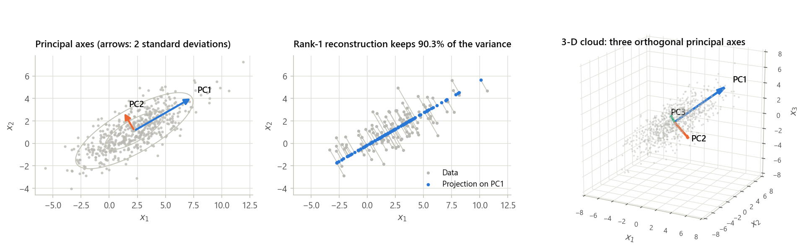

On synthetic Gaussian clouds with known covariance, the estimated axes are within 0.14° (2-D, 500 samples) and 1.4–2.1° (3-D, 800 samples) of the true eigenvectors.

## More figures

| | |
|---|---|
| 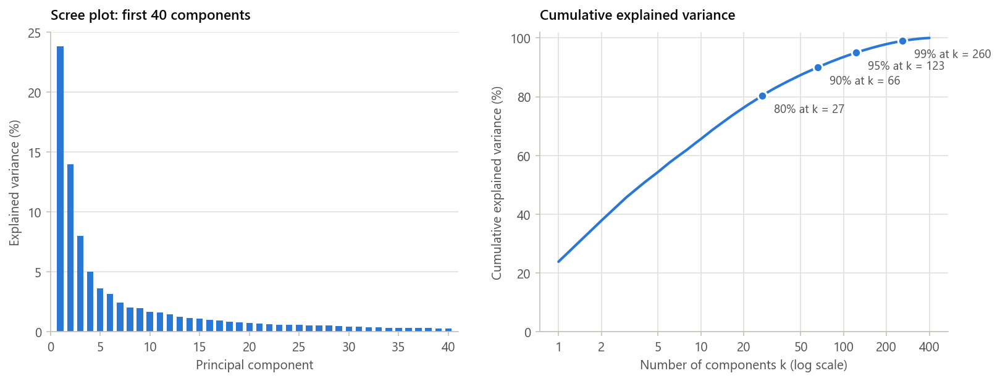 | 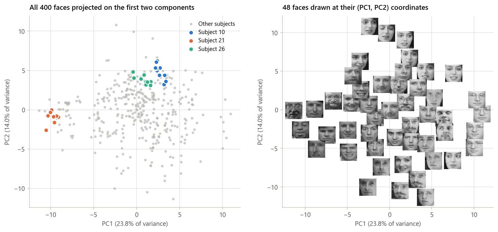 |
| 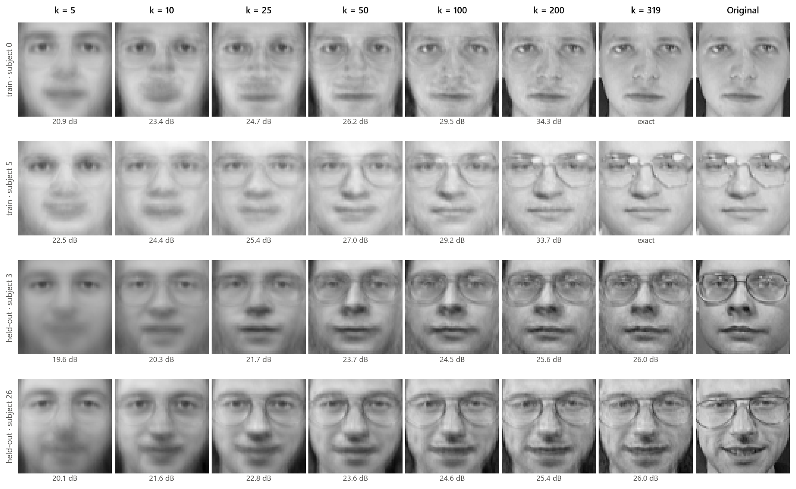 | 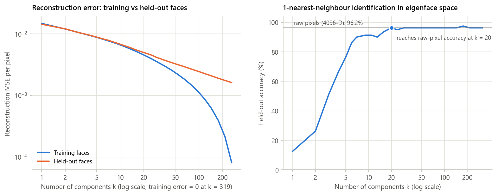 |
| 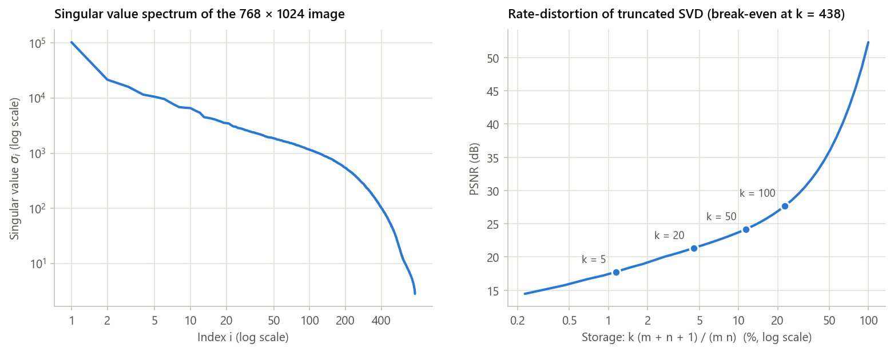 | 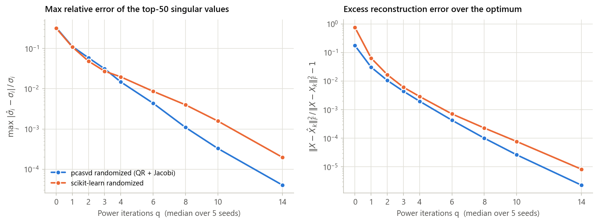 |

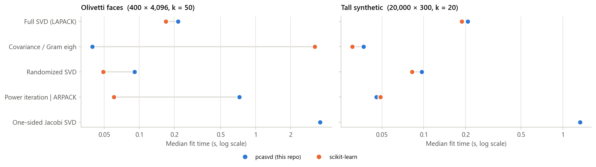

## Project structure

```
pca_svd_from_scratch/
├── pcasvd/
│   ├── pca.py           # PCA estimator: fit / transform / inverse_transform, 5 solvers, Gram trick
│   ├── linalg.py        # from scratch: Jacobi SVD, power iteration, randomized SVD, sign convention
│   ├── compression.py   # truncated SVD, Eckart-Young bound, storage ratio, PSNR
│   ├── datasets.py      # Olivetti faces, Gaussian clouds, raccoon image (cached in data/)
│   ├── metrics.py       # reconstruction error, agreement with a reference, 1-NN accuracy
│   ├── plots.py         # every static figure
│   ├── animation.py     # progressive-reconstruction GIF
│   └── timing.py        # wall-clock timing and hardware description
├── tests/               # 65 pytest tests (solvers vs sklearn / LAPACK / known spectra)
├── demo.py              # regenerates assets/ + results/metrics.json, prints the comparison table
├── benchmark.py         # timing vs scikit-learn + randomized-SVD accuracy study
├── assets/              # figures used in this README
├── results/metrics.json # every number reported here
├── requirements.txt
└── pyproject.toml       # project metadata + pytest configuration
```

## Quickstart

```bash
git clone https://github.com/stein900/pca_svd_from_scratch.git
cd pca_svd_from_scratch
python -m venv .venv
source .venv/bin/activate        # Windows: .venv\Scripts\activate
pip install -r requirements.txt

python demo.py                   # figures -> assets/, metrics -> results/metrics.json
python benchmark.py              # timing benchmark (adds a "benchmark" section to metrics.json)
python -m pytest                 # 65 tests
```

The first run downloads the Olivetti faces (via scikit-learn, cached as a 1.4 MB file) and the raccoon image (via `scipy.datasets` / `pooch`) into `data/`, which is git-ignored.

```python
from pcasvd import PCA

pca = PCA(n_components=50, solver="jacobi").fit(X)  # or "svd", "covariance_eigh", "power", "randomized"
Z = pca.transform(X)
X_hat = pca.inverse_transform(Z)
print(pca.explained_variance_ratio_.sum())
```

## Reproducibility

* **Seeds.** Every random choice (train/test split, power-iteration start vectors, randomized sketches, synthetic data) uses seed 0, except the 3-D Gaussian cloud (seed 1). The randomized-accuracy study reports the median over seeds 0–4. Signs are fixed by the convention above, so outputs are deterministic.
* **Data.** Olivetti faces (AT&T Laboratories Cambridge, via `sklearn.datasets.fetch_olivetti_faces`), 400 images of 40 subjects, 64 × 64 grey levels in [0, 1]. The raccoon photo is `scipy.datasets.face(gray=True)`, derived from [pixnio.com](https://pixnio.com/fauna-animals/raccoons/raccoon-procyon-lotor) (CC0 public domain).
* **Hardware.** AMD Ryzen 7 7800X3D (8 cores / 16 threads), 31 GB RAM, Windows 11, Python 3.12.10, NumPy 2.5.2 with OpenBLAS 0.3.34 (default threading), scikit-learn 1.8.0.
* **Measured runtime.** `python demo.py` took 25.6 s (datasets already cached), `python benchmark.py` 94.4 s, and `python -m pytest` 6 s (65 tests). The machine was shared with other jobs. During the final benchmark, system-wide CPU load (sampled every 5 s, including the benchmark's own BLAS threads) had a median of 34 % and a maximum of 70 %. An earlier benchmark run under heavy concurrent load (82–99 %) gave absolute times 1.5× to 23× higher and even reversed some orderings. Treat the ratios between algorithm families as more robust than the absolute times.

## Limitations and next steps

* **The from-scratch solvers are for understanding and verification, not speed.** Jacobi loops over rounds in Python (O(k³) work per sweep plus interpreter overhead). It is about 17× slower than the LAPACK SVD on the faces. Power iteration converges like $\lambda_{i+1}/\lambda_i$ and stalls on clustered spectra, where ARPACK's Lanczos method is 12× faster.
* **The Gram trick squares the condition number.** Directions with $\sigma_i < \sqrt{n\varepsilon}\,\sigma_1$ cannot be resolved from $X_cX_c^\top$. They are completed with an orthonormal basis, so their axes are arbitrary (as they are for any solver on rank-deficient data).
* **Randomized SVD on slowly decaying spectra.** Face spectra decay slowly, so the default q = 4 still leaves up to 1.5 % relative error on the top-50 singular values, and q = 10 brings it down to 3.3 × 10⁻⁴ ([figure](assets/randomized_power_iterations.png)).
* **Small evaluation set.** The 1-NN test set has 80 images, so one image is 1.25 points of accuracy. The 97.5 % peak at k = 176 is one image away from 96.25 % and is not a meaningful improvement.
* **Scope.** Dense, in-memory, float64 data only. Natural next steps: block Lanczos / LOBPCG, incremental (out-of-core) PCA, a PyTorch/GPU backend, probabilistic PCA (noise variance), and kernel PCA.

## References

1. K. Pearson, *On lines and planes of closest fit to systems of points in space*, Philosophical Magazine, 1901.
2. H. Hotelling, *Analysis of a complex of statistical variables into principal components*, J. Educational Psychology, 1933.
3. C. Eckart and G. Young, *The approximation of one matrix by another of lower rank*, Psychometrika, 1936.
4. M. R. Hestenes, *Inversion of matrices by biorthogonalization and related results*, J. SIAM, 1958.
5. J. Demmel and K. Veselić, *Jacobi's method is more accurate than QR*, SIAM J. Matrix Anal. Appl., 1992.
6. M. Turk and A. Pentland, *Eigenfaces for recognition*, J. Cognitive Neuroscience, 1991.
7. F. Samaria and A. Harter, *Parameterisation of a stochastic model for human face identification*, IEEE WACV, 1994 (ORL / Olivetti database).
8. N. Halko, P.-G. Martinsson and J. A. Tropp, *Finding structure with randomness: probabilistic algorithms for constructing approximate matrix decompositions*, SIAM Review, 2011.
9. G. H. Golub and C. F. Van Loan, *Matrix Computations*, 4th ed., Johns Hopkins University Press, 2013.
10. F. Pedregosa et al., *Scikit-learn: Machine Learning in Python*, JMLR, 2011.

## License

MIT. See [LICENSE](LICENSE).

## Author

**Raphaël Laurent**, AI Scientist / computer engineer. Full technical write-up: [stein-ind.fr/Portfolio/projects/pca_svd.html](https://stein-ind.fr/Portfolio/projects/pca_svd.html)
